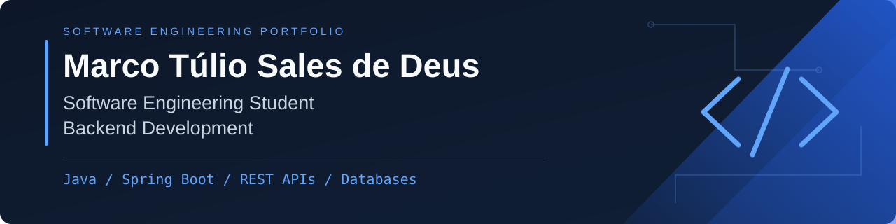

**Português** · [English](README.md)

## Sobre mim

Sou estudante de Engenharia de Software na PUC Minas, com foco em desenvolvimento Backend utilizando Java e Spring Boot. Por meio de projetos pessoais e acadêmicos colaborativos, venho adquirindo experiência prática em desenvolvimento Full Stack, integração com bancos de dados, versionamento e publicação de aplicações.

Tenho interesse em arquitetura de software, aplicações seguras e de fácil manutenção, e oportunidades de estágio em desenvolvimento de software.

## Tecnologias e ferramentas

**Foco principal**

   

| Área | Tecnologias e conceitos |
| --- | --- |
| Backend e persistência | Java, Spring Boot, Spring Data JPA, Node.js, Express |
| Bancos de dados | PostgreSQL, MongoDB, H2 |
| Desenvolvimento web | JavaScript, HTML, CSS |
| Ferramentas | Git, GitHub, Maven, VS Code, Vercel |
| Em desenvolvimento | Docker, MySQL, Clean Architecture, testes automatizados, segurança de aplicações, Playwright |

## Projetos em destaque

### TradeLens — Comunidade do Mercado Financeiro

Aplicação web acadêmica colaborativa desenvolvida na PUC Minas, integrando funcionalidades sociais e informações do mercado financeiro. Minhas contribuições incluem publicações, funcionalidades de seguir usuários e redesign da interface.

**Stack:** JavaScript, Node.js, Express, MongoDB Atlas, Vercel.

[Aplicação hospedada](https://tradelens-neon.vercel.app/) · [Repositório institucional (acesso possivelmente restrito)](https://github.com/ICEI-PUC-Minas-PMGES-TI/pmg-es-2026-2-ti2-8243100-stockmarketcommunity)

### Fit Manager API

Projeto pessoal Backend voltado à avaliação e gestão física, utilizando Java e Spring Boot para explorar o desenvolvimento de APIs REST e persistência de dados.

[Acessar repositório](https://github.com/MarcoTulioES/fit-manager-api)

### Java Task Manager

Projeto de gerenciamento de tarefas desenvolvido para praticar Java, programação orientada a objetos e organização de aplicações.

[Acessar repositório](https://github.com/MarcoTulioES/java-task-manager)

## Formação acadêmica

**Bacharelado em Engenharia de Software — em andamento**  
Pontifícia Universidade Católica de Minas Gerais (PUC Minas)  
Belo Horizonte, Brasil

## Contato

 

Aberto a oportunidades de estágio em desenvolvimento Backend e de software.
