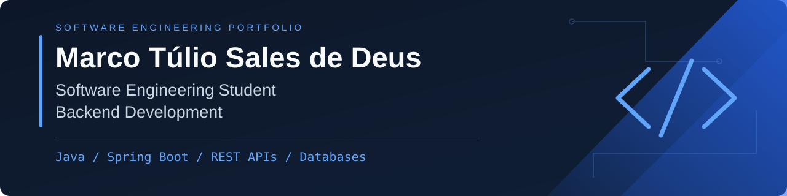

[Português](README-pt.md) · **English**

## About me

I'm a Software Engineering student at PUC Minas, Brazil, focused on backend development with Java and Spring Boot. Through personal and collaborative academic projects, I have gained hands-on experience with full-stack development, database integration, version control and application deployment.

I'm interested in software architecture, secure and maintainable applications, and internship opportunities in software development.

## Technical toolkit

**Main focus**

   

| Area | Technologies and concepts |
| --- | --- |
| Backend and persistence | Java, Spring Boot, Spring Data JPA, Node.js, Express |
| Databases | PostgreSQL, MongoDB, H2 |
| Web development | JavaScript, HTML, CSS |
| Development tools | Git, GitHub, Maven, VS Code, Vercel |
| Currently exploring | Docker, MySQL, Clean Architecture, automated testing, application security, Playwright |

## Featured projects

### TradeLens — Financial Market Community

A collaborative academic web application developed at PUC Minas, combining social features and financial market information. My contributions include posts, user-following features and interface redesign.

**Stack:** JavaScript, Node.js, Express, MongoDB Atlas, Vercel.

[Live application](https://tradelens-neon.vercel.app/) · [Institutional repository (access may be restricted)](https://github.com/ICEI-PUC-Minas-PMGES-TI/pmg-es-2026-2-ti2-8243100-stockmarketcommunity)

### Fit Manager API

A personal backend project focused on fitness assessment and management, using Java and Spring Boot to explore REST API development and data persistence.

[View repository](https://github.com/MarcoTulioES/fit-manager-api)

### Java Task Manager

A task management project developed to practice Java, object-oriented programming and application organization.

[View repository](https://github.com/MarcoTulioES/java-task-manager)

## Education

**Bachelor's degree in Software Engineering — in progress**  
Pontifical Catholic University of Minas Gerais (PUC Minas)  
Belo Horizonte, Brazil

## Contact

 

Open to internship opportunities in backend and software development.
